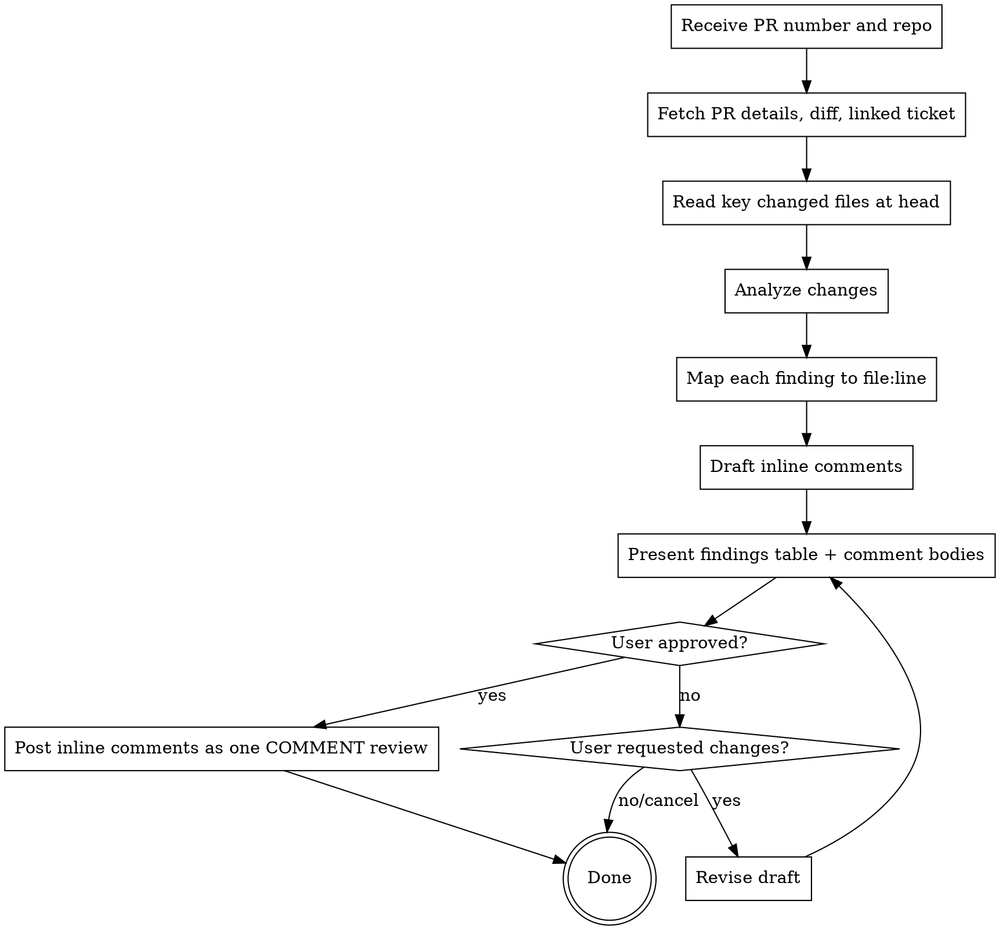

# Interactive PR Review

Review a PR, identify issues anchored to specific `file:line` locations, draft **inline comments** for approval, then post them as a single Comment-type review only when explicitly approved.

Default output is **inline comments at file + line**, not one summary blob. A summary comment is opt-in (user asks for it).

## Workflow



## Required Information

Before starting, confirm you have:

- Repository in `owner/repo` format
- PR number
- (Optional) a linked ticket ID — fetch it for context if provided

If repo/PR aren't provided, ask.

## Gathering Context

```bash
# Metadata + commits (grab the head SHA for the review payload)
gh pr view <n> --repo <owner/repo> --json title,body,author,state,additions,deletions,changedFiles,baseRefName,headRefName,url,commits

# Full diff
gh pr diff <n> --repo <owner/repo>
```

Don't review from the diff alone. Fetch the branch and read the key changed files at head so line numbers are accurate and you understand surrounding code:

```bash
git fetch origin <headRefName>
git show origin/<headRefName>:path/to/file.ex        # read full file
git show origin/<headRefName>:path/to/file.ex | grep -n "def something"   # find anchor lines
```

Line numbers for inline comments are the **new-file (RIGHT side)** numbers from the head version, and each anchored line must fall inside the diff hunks (added or context lines). New files: use their own line numbers.

## Analysis Output Format

Present findings, then the exact inline comments that would post. Use a table so the user can scan and prune:

```markdown
## PR Summary

[1-2 sentences on what the PR does; note the linked ticket if any]

## Findings

| #   | File:line         | Severity | Point              |
| --- | ----------------- | -------- | ------------------ |
| 1   | `path/file.ex:45` | Medium   | [one-line summary] |
| 2   | `path/other.ex:6` | Low      | [one-line summary] |

## Draft Inline Comments

**1. `path/file.ex:45` (Medium)**

> [exact comment body — what's wrong, why it matters, suggested fix]

**2. `path/other.ex:6` (Low)**

> [exact comment body]

**Review type:** Comment (default)

Ready to post? Say "post it", or tell me what to change.
```

Guidance for good inline comments:

- One finding per comment, anchored where the reader can act on it.
- Lead with the concrete failure/impact, then the fix. Match severity to reality — don't inflate nits to Medium.
- Cross-reference related comments ("see comment on `x.ex`") when one is the root cause of another.
- Keep the user's voice: direct, first person where natural, no ceremony. Flag the one that actually matters; call the rest nits.

## Posting (only after approval)

Post **one** review with all inline comments batched. Write the payload to a temp file and use the reviews API:

```bash
cat > /tmp/pr_review.json <<'EOF'
{
  "commit_id": "<head SHA from gh pr view>",
  "event": "COMMENT",
  "comments": [
    { "path": "path/file.ex",  "line": 45, "side": "RIGHT", "body": "..." },
    { "path": "path/other.ex", "line": 6,  "side": "RIGHT", "body": "..." }
  ]
}
EOF

gh api repos/<owner>/<repo>/pulls/<n>/reviews --method POST --input /tmp/pr_review.json
```

- `event`: `COMMENT` by default. Only `APPROVE` or `REQUEST_CHANGES` if the user explicitly asks.
- Omit the top-level `body` unless the user wants a summary comment alongside the inline ones.
- For a multi-line anchor, add `"start_line"` + `"start_side"` alongside `"line"`.
- After posting, report the returned `html_url`.

If the API rejects a line as outside the diff, re-check the anchor against the diff hunks (wrong side or a line that wasn't actually changed).

## Approval Triggers

Only post after explicit approval: "post it", "submit", "looks good, post", "approve and post".

## Revision Triggers

Revise before posting when the user says things like: "soften the tone", "drop point X", "add a note about...", "be more specific about...", "move that comment to line N", "switch to Request Changes", "add a summary comment too".

## Do NOT Post When

- User says "cancel", "nevermind", "stop"
- User hasn't explicitly approved
- User is still asking questions about the PR
- No explicit approval phrase was given

## Review Types

| Type            | When to Use                                |
| --------------- | ------------------------------------------ |
| Comment         | Default — feedback, questions, suggestions |
| Approve         | Code looks good, minor or no issues        |
| Request Changes | Only when the user explicitly asks         |

Default to **Comment**. Never escalate to Request Changes on your own initiative.
